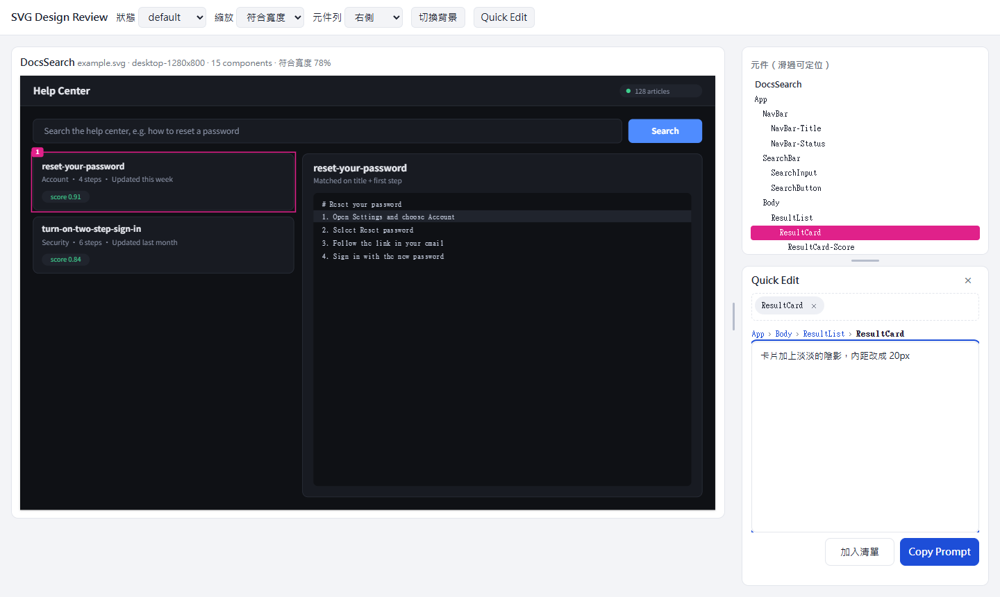
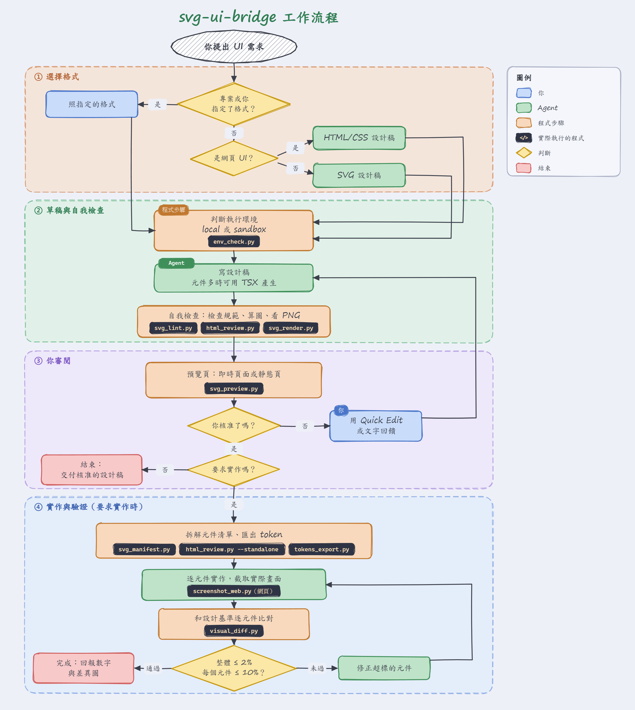

<h1 align="center">svg-ui-bridge</h1>

<p align="center">讓 Claude Code 先畫出 HTML 或 SVG 設計稿、經你核准再寫程式，最後用像素比對證明成品符合設計。</p>

<p align="center">
  <a href="README.md">English</a> ·
  <a href="docs/zh-TW/workflow.md">工作流程</a> ·
  <a href="docs/zh-TW/svg-conventions.md">SVG 規範</a> ·
  <a href="docs/zh-TW/framework-mapping.md">框架對照</a> ·
  <a href="docs/zh-TW/workflow-integration.md">整合 superpowers</a> ·
  <a href="https://github.com/ETEason/svg-ui-bridge/releases">版本發佈</a>
</p>

<p align="center">
  
  
  <a href="https://github.com/ETEason/svg-ui-bridge/actions/workflows/ci.yml"></a>
  <a href="LICENSE"></a>
</p>

<p align="center">
  
</p>

只用文字描述畫面時，人和 AI 很容易各想各的，等程式寫完才發現不對。這個 skill 把 SVG 當成共同語言：你看渲染出來的畫面，Claude 讀有命名、有分層的標記，所以修改發生在設計稿上，而不是反覆重寫程式。

## ✨ 功能

| 階段 | 做什麼 | 工具 |
|---|---|---|
| 1. 繪製 | 把畫面寫成結構化 SVG：每個元件有名稱，顏色與間距是設計 token，hover、disabled 等狀態是獨立圖層 | Claude 依 [SVG 規範](docs/zh-TW/svg-conventions.md) 撰寫 |
| 2. 檢查與核准 | 檢查規範，在瀏覽器即時預覽；**你核准前不寫產品程式** | `svg_lint.py`、`svg_preview.py`、`svg_render.py` |
| 3. 拆解 | 產生元件清單：樹狀結構、實測位置大小、token、狀態、建議實作順序 | `svg_manifest.py` |
| 4. 實作 | 從 SVG 匯出主題檔，再逐元件實作，每個任務只給該元件的資料以節省 token | `tokens_export.py` |
| 5. 驗證 | 把實際畫面截圖與設計稿比對，整體與每個元件都要過門檻（預設整體 ≤ 2%、單一元件 ≤ 10%） | `visual_diff.py` |
| 6. 後續修改 | 視覺調整一律先改 SVG，SVG 是外觀的唯一依據 | 回到階段 1 |

只要求設計時，到你核准設計稿就結束；要求實作時才進行階段 3 到 5。適用網頁，也適用 Rust egui/iced/Bevy、Qt、遊戲 HUD 等非網頁介面。可以放進 [superpowers](https://github.com/obra/superpowers) 的 brainstorming 設計步驟裡使用。

<p align="center">
  
</p>

各階段的細節，以及兩種格式的渲染方式與 Quick Edit 的來回，見[工作流程](docs/zh-TW/workflow.md)。

## 🚀 快速開始

安裝 plugin：

```
claude plugin install svg-ui-bridge --marketplace ETEason/svg-ui-bridge
```

安裝腳本需要的 Python 套件與算圖器：

```
python -m pip install pillow playwright
```

Windows 請把 `python` 換成 `py`。需要 Python 3.10 以上。TSX 範例另外需要 Node.js 與 npm，其他功能都不需要。

接著開新的 Claude Code session，直接提 UI 需求，Claude 會自行載入這個 skill；也可以用 `/svg-ui-bridge:svg-ui-bridge` 手動呼叫。

預覽頁用預設瀏覽器開啟。腳本算 PNG 時透過 Playwright 使用電腦裡的 Chrome 或 Edge；兩者都沒有時，請執行 `python -m playwright install chromium`。網頁專案建議設定 `SVG_UI_RENDERER=playwright`，讓參考圖和 App 由同一種引擎算圖，文字誤差較小。

<details>
<summary>其他安裝方式</summary>

舊版 Claude Code 用兩步驟安裝：

```
claude plugin marketplace add ETEason/svg-ui-bridge
claude plugin install svg-ui-bridge@svg-ui-bridge
```

固定在某個版本：

```
claude plugin marketplace add ETEason/svg-ui-bridge#v0.1.0
```

更新：

```
claude plugin update svg-ui-bridge@svg-ui-bridge
```

讓整個專案的人共用（也適用雲端 session），在該 repo 執行一次，再 commit `.claude/settings.json`：

```
claude plugin marketplace add ETEason/svg-ui-bridge --scope project
```

其他 agent 或沒有 plugin 系統時：

```
npx skills add ETEason/svg-ui-bridge
```

也可以手動把 `skills/svg-ui-bridge/` 複製到 `<專案>/.claude/skills/` 或 `~/.claude/skills/`。擇一安裝就好，不要重複。

</details>

<details>
<summary>安裝後的選用設定</summary>

1. 要讓所有專案的 UI 工作都走這個流程：把 [全域片段](docs/zh-TW/global-CLAUDE.md) 附加到 `~/.claude/CLAUDE.md`。這會讓小改動也要先畫 SVG。
2. 個別專案：把 [專案範本](docs/zh-TW/project-CLAUDE.md) 貼進專案的 `CLAUDE.md` 並填好，再把 `skills/svg-ui-bridge/templates/gitignore.snippet` 加進 `.gitignore`。

</details>

## ✏️ 用 Quick Edit 指出要改的地方

在預覽頁直接指給 Claude 看，不用文字描述位置。Quick Edit 開在側欄、元件列的下方，和設計稿並排而不會蓋住它。用頂部的「元件列」選單把側欄放在右側（預設）或左側，或隱藏元件列；拖曳分隔線可調整大小。視窗窄或直式時不顯示元件列，Quick Edit 固定在設計稿下方，兩者同時看得到。這些選擇會記在瀏覽器裡。

設計稿維持設計尺寸。預覽區被對話框或側欄擠壓時，縮放會把所有設計稿等比縮小（預設「符合寬度」），不會改變設計稿裡任何東西的位置。響應式排版是成品的事，不是草稿的事。

| 動作 | 操作 |
|---|---|
| 選取元件 | 點一下，選到滑鼠下最深層的元件 |
| 多選 | Shift 或 Ctrl＋點擊 |
| 擴大選取範圍 | 點 breadcrumb 的任一層，例如 `App › SearchBar › SearchButton` |
| 標出空白區域 | 按住 Alt 拖曳 |
| 累積多筆修改 | 寫好一筆後按「加入清單」，再選下一處 |
| 複製給 Claude | Copy Prompt，或 Ctrl/Cmd＋Enter |
| 調整側欄 | 「元件列」選右側、左側或不顯示；拖曳分隔線調整大小；Esc 關閉 Quick Edit |
| 縮放 | 「符合寬度」（預設）或固定比例；設計稿內的排版不會改變 |

把複製的文字貼給 Claude，它會先用 `svg_render.py --job` 重現你看到的畫面確認位置，再改 SVG。剪貼簿被擋時，面板會顯示全文讓你手動複製。`--serve` 模式下可按「送給 Agent」，內容會寫到 `design/_feedback.md`。prompt 預設用相對路徑，加 `--absolute-paths` 才是絕對路徑。

## 🧭 選擇設計格式

專案沒有指定時只看一條規則：**網頁 UI 用 HTML/CSS，其他都用 SVG**（原生 app、遊戲與 HUD、圖表）。兩者都有即時預覽、Quick Edit、元件清單、token 匯出和逐元件視覺比對。HTML 設計稿以設計寬度呈現，也可在預覽頁切換成 1280、768 或 390，所以響應式頁面只要一個檔案，不必每個斷點各畫一份 SVG。詳見 [HTML 設計路線](docs/zh-TW/html-design.md)。

元件重複或變體很多時，可用 TSX 元件搭配共用主題，在建置時產生設計稿。[examples/tsx-design](examples/tsx-design) 是鎖定版本、有型別檢查的範例；詳見[元件化撰寫](docs/zh-TW/component-authoring.md)。

## 💻 在桌面 app／claude.ai 使用

一般對話與雲端任務在沙盒裡執行，要把 skill 上傳到帳號：

1. 從最新版本下載 [svg-ui-bridge-skill.zip](https://github.com/ETEason/svg-ui-bridge/releases/latest/download/svg-ui-bridge-skill.zip)。
2. 開啟 **Customize > Skills**（[claude.ai/customize/skills](https://claude.ai/customize/skills)），上傳 zip 並啟用。
3. 問一句「你載入的 svg-ui-bridge 是哪個版本？」確認，答案是 `SKILL.md` 裡的 `Version:` 那一行。

要更新時，下載最新的 zip 重新上傳。skill 會用 `scripts/env_check.py` 判斷自己在哪裡執行：

| | 電腦上的 Claude Code（`MODE=local`） | 沙盒（`MODE=sandbox`） |
|---|---|---|
| Skill 名稱 | `/svg-ui-bridge:svg-ui-bridge` | `svg-ui-bridge` |
| 審閱 | `localhost:8765` 的即時頁面 | 靜態頁，發佈成 artifact 或以檔案傳送 |
| 驗證 | 截取你執行中的 app | 網頁：沙盒內啟動的頁面。原生 app 或遊戲：你上傳的截圖 |
| superpowers、pstack | 有安裝就使用 | 不需要 |

兩邊的核准關卡和視覺比對證據同樣嚴格。細節見[執行環境](docs/zh-TW/environments.md)。

## 🔒 安全性

- plugin 不含 hooks、MCP server 或執行檔。lint hook 是選用的，要自己加才會執行。
- 腳本本身只讀寫本機檔案，執行時不會下載或上傳。`svg_preview.py --serve` 只綁定 `127.0.0.1`。`screenshot_web.py` 只開啟你指定的網址或檔案，並封鎖對其他來源的請求。
- **不要用預覽頁開來源不明的 SVG。** 預覽頁會把 SVG 內容直接放進網頁，惡意 SVG 可能在頁面裡執行 JS 或連到外部網址。
- 安裝任何 skill 前都建議先看過程式碼，也可以固定 tag，只在你決定時才更新。

## 🧪 開發

```
git clone https://github.com/ETEason/svg-ui-bridge.git
cd svg-ui-bridge
python tests/smoke_test.py
```

結尾應顯示 `ALL SMOKE TESTS PASSED`。沒有裝算圖器時可加 `--no-render` 跳過算圖檢查。CI 會在 Ubuntu 與 Windows 上用 Python 3.10、3.13 執行同一份測試。

<details>
<summary>專案結構</summary>

| 路徑 | 用途 |
|---|---|
| `.claude-plugin/` | plugin 與 marketplace 設定 |
| `skills/svg-ui-bridge/SKILL.md` | Claude 遵循的工作流程（6 個階段、關卡、常見錯誤想法） |
| `skills/svg-ui-bridge/references/` | SVG 規範、HTML 路線、元件化撰寫、執行環境、superpowers/pstack 整合、SVG 到各框架的對照 |
| `scripts/env_check.py` | 回報作業系統、Python、Pillow、可用的算圖器，以及 `MODE=local` 或 `MODE=sandbox` |
| `scripts/svg_lint.py` | 檢查 SVG 是否符合規範 |
| `scripts/svg_preview.py` | 瀏覽器預覽頁，`--serve` 會在 SVG 變更時自動重新載入 |
| `scripts/svg_render.py` | 輸出 PNG 給 Claude 自我檢查（可指定狀態或單一元件） |
| `scripts/svg_manifest.py` | 產生元件清單與實作順序 |
| `scripts/tokens_export.py` | 匯出 token 為 CSS、TS、egui、Bevy 或 JSON |
| `scripts/screenshot_web.py` | 截取網址或 HTML 檔，供 `visual_diff.py` 比對 |
| `scripts/visual_diff.py` | 比對截圖與設計稿，輸出差異圖與結束碼 |
| `scripts/html_review.py` | 檢查 HTML 設計稿：輸出畫面 PNG 與元件清單，檢查 id、資源與溢出；`--standalone` 產生比對基準 |
| `templates/html-design/` | 可離線開啟、含兩種狀態的 HTML/CSS 草稿範本 |
| `examples/tsx-design/` | 用 TSX 元件產生 SVG 的範例；不屬於安裝後的 skill |
| `scripts/lint_hook.py` | 選用的 PostToolUse hook，自動檢查 Claude 寫出的 SVG |
| `tools/build_skill_zip.py` | 驗證 `SKILL.md` 並產生上傳用的 zip |
| `tools/draw_diagrams.py` | 重新產生 `docs/images/` 的流程圖（中英文） |
| `tests/smoke_test.py` | 端對端冒煙測試 |

`scripts/` 都在 `skills/svg-ui-bridge/` 底下。

</details>

## 📚 文件

- [工作流程](docs/zh-TW/workflow.md)：每個階段的完整步驟與關卡
- [SVG 規範](docs/zh-TW/svg-conventions.md)：設計稿該怎麼寫
- [執行環境](docs/zh-TW/environments.md)：本機與沙盒的流程差異
- [HTML 設計路線](docs/zh-TW/html-design.md)：文字多、響應式畫面的設計與檢查
- [元件化撰寫](docs/zh-TW/component-authoring.md)：用 TSX 元件與共用主題產生設計稿
- [框架對照](docs/zh-TW/framework-mapping.md)：SVG 屬性如何對應到各框架
- [整合 superpowers 與 pstack](docs/zh-TW/workflow-integration.md)：為什麼放在設計階段，以及各階段怎麼銜接
- [專案 CLAUDE.md 範本](docs/zh-TW/project-CLAUDE.md)、[全域 CLAUDE.md 片段](docs/zh-TW/global-CLAUDE.md)

## ⚠️ 限制

- **Windows 不支援萬用字元**：PowerShell 和 cmd 不會展開 `design/*.svg`。`svg_lint.py` 請逐檔傳入，`svg_preview.py` 請傳資料夾，例如 `svg_preview.py design`。
- **文字不會完全一致**：不同算圖器與原生 UI 工具的字型渲染不同，所以 `visual_diff.py` 有容差設定，文字請看位置和大小，不要追求逐像素相同。
- **`visual_diff.py` 需要你提供截圖**：截圖要和 SVG 畫布是同一區域。

## 📄 授權

[MIT](LICENSE)
