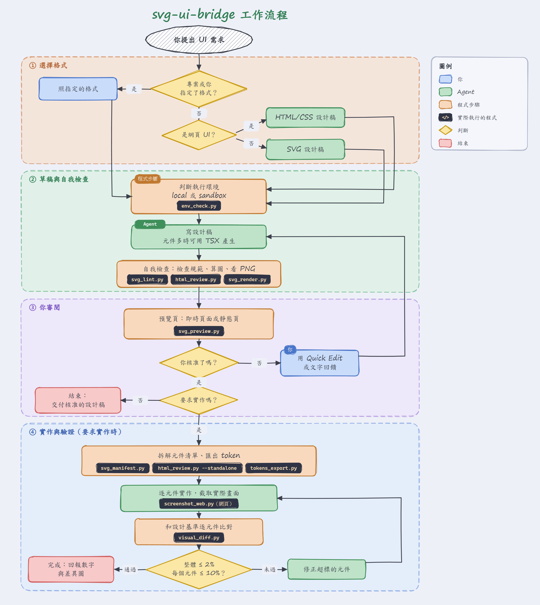
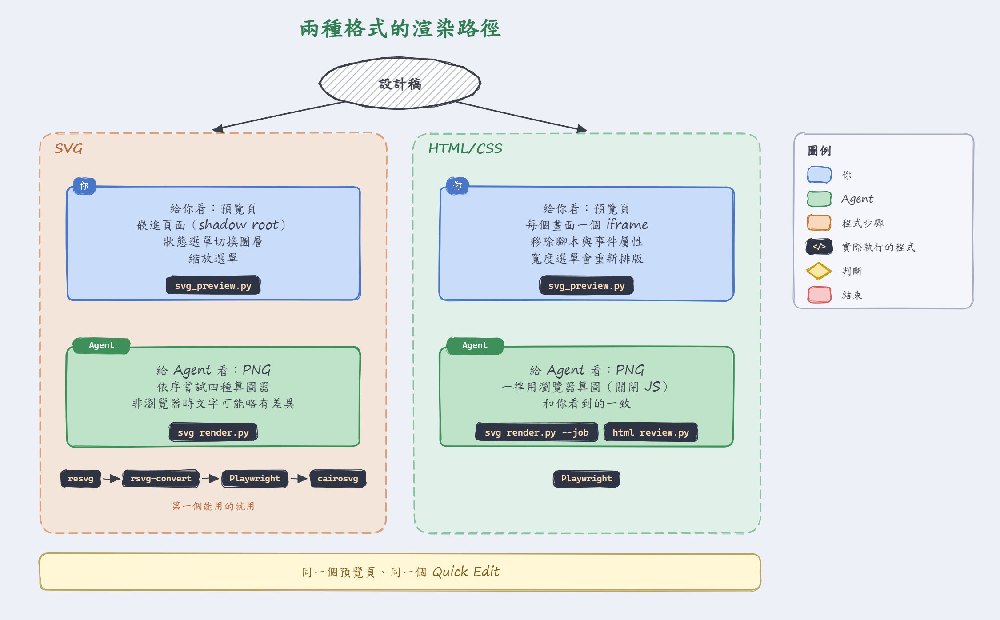
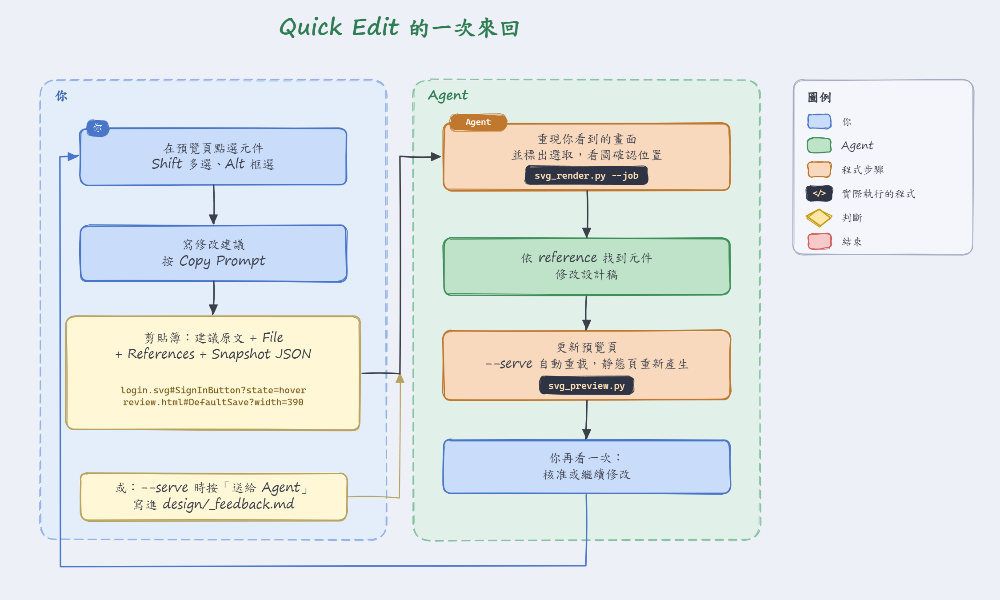

# svg-ui-bridge 工作流程

[English](../../skills/svg-ui-bridge/SKILL.md)

版本：0.7.2



算圖後的設計稿是人的視覺意圖和 agent 程式碼之間的共同語言：人判斷渲染出來的畫面，agent 讀有命名、有分層、用 token 表示的標記。要反覆修改的是畫面，不是程式碼。設計稿可以是結構化 SVG 或靜態 HTML/CSS，兩者走同一套流程。

下文的 `<skill>` 指包含 SKILL.md 的資料夾。請從這個檔案的載入位置推得，因為每種安裝方式都不同。腳本放在 `<skill>/scripts/`（需要 Python 3 與 Pillow，再加一種 SVG 算圖器：resvg、rsvg-convert、搭配系統 Chrome/Edge 的 Playwright，或 cairosvg）。

## 適用時機

- 適用：任何有視覺結果的工作，包含小調整（「移動按鈕」、「卡片加深」）。
- 略過：純邏輯或後端變更、只改文案，或使用者說「不用畫稿」。
- 搭配 superpowers：本流程在 **brainstorming 的設計步驟之內**執行，影響規格、計畫任務和驗證證據，不取代 superpowers 的任何階段。詳見[整合 superpowers 與 pstack](workflow-integration.md)（superpowers 或 pstack skill 啟用時請閱讀）。兩者都是選用的：沒有時照下列步驟走，不必提起它們。

## 選擇格式

專案或使用者已選定格式時照用，否則只看一條規則：

- **網頁 UI**（最後會做成 HTML/CSS）：用 HTML/CSS 設計稿。指令見 [HTML 設計路線](html-design.md)，流程與規則和下方相同。
- **其他**（原生 app、遊戲與 HUD、圖表、固定座標的圖形）：用 SVG，照下方步驟。

元件大量重複時，可用 TSX 搭配共用主題產生設計稿，見[元件化撰寫](component-authoring.md)。小型草稿直接手寫。

兩種格式在預覽頁與 Agent 端的渲染方式：



## Step 0：判斷環境

```
python <skill>/scripts/env_check.py
```

最後一行是 `MODE=local` 或 `MODE=sandbox`。模式是 `sandbox` 或缺少工具時，請閱讀[執行環境](environments.md)。

| 步驟 | `MODE=local` | `MODE=sandbox` |
|---|---|---|
| 預覽 | `svg_preview.py design --serve`，把網址告訴使用者 | 每次編輯 SVG 後重新產生靜態 `_preview.html`，發佈成 artifact 或傳送檔案 |
| 驗證 | 截取使用者電腦上的 app | 網頁：對沙盒內啟動的頁面跑 `screenshot_web.py`。原生 app 或遊戲：請使用者上傳指定尺寸的截圖 |

以下規則在兩種模式、兩種格式下同樣嚴格：

- **核准關卡：** 使用者看過設計並核准前，不寫產品程式。
- **範圍：** 只要求設計時，交付檢查過的草稿並經使用者審閱即結束。要求實作時，才繼續拆解、實作與截圖驗證。核准只在當時約定的範圍內有效。
- **實作證據：** `visual_diff.py` 在真實截圖上通過前，實作不算通過視覺驗證（HTML 是和 `html_review.py --standalone` 的基準比對）。拿不到截圖時，要說明視覺檢查尚未完成。絕不把草稿稱為已驗證的實作。

## 流程

### 1. 繪製 SVG（設計階段，還沒有產品程式）

- 在一個 session 寫第一份 SVG 前，先讀 [SVG 規範](svg-conventions.md)。
- 寫出或產生 `design/<畫面>.svg`（或專案 CLAUDE.md 指定的資料夾）。由 TSX 產生時，修改來源後重新建置，不要直接改輸出。專案已有畫面或 token 時，沿用它們並延續既有外觀；使用者提供截圖或草圖時，描出它的結構。
- 每個元件都是 `<g id="PascalCase" data-component="Kind">`；子元件依 `data-layout` 排列；變體是 `data-state` 圖層；顏色與間距是 `<style>` 裡的 CSS 變數。

### 2. 檢查、預覽、人工關卡

```
python <skill>/scripts/svg_lint.py design/<screen>.svg
python <skill>/scripts/svg_preview.py design --serve        # 人：瀏覽器即時預覽頁（local）
python <skill>/scripts/svg_preview.py design --no-open       # 人：要發佈的靜態頁（sandbox）
python <skill>/scripts/svg_render.py design/<screen>.svg     # agent：用 Read 查看的 PNG
```

- 每次修改來源後，先重新建置產生的 SVG，再執行這些指令。
- 決策所依據的狀態或方案，各自輸出成同尺寸的 SVG，讓預覽頁並排顯示。說明文字放在 UI 之外，並記錄核准的檔案、狀態與尺寸。狀態切換是檢查用的，不能是發現各種方案的唯一途徑。
- 修正所有 ERROR；warning 也要修，除非有明確理由。
- **人在瀏覽器上審閱**，不看 XML，也不看 PNG：`svg_preview.py --serve` 會開啟 http://localhost:8765 的頁面，`design/` 裡的 SVG 一變更就自動重新載入，並提供狀態切換（default/hover/disabled…）、滑過辨識元件（id、layout、note）和縮放。設計稿維持設計尺寸；預覽區被擠壓時整張等比縮小（預設「符合寬度」，每張卡片各自縮放），不會重新排版。設計工作開始時在背景啟動一次，並把網址告訴使用者。
  不想讓程序長時間執行時：`svg_preview.py design` 會寫出 `design/_preview.html` 並開啟。
- **Agent 先檢查自己的畫稿**：請使用者看之前，先算出 PNG 並讀取（檢查重疊、文字被裁切、對不齊）。`--all-states` 會算出每種狀態。
- 用視覺語言徵求回饋。把回饋改進 SVG 或其來源（再重新建置）→ 重新檢查 →（預覽自動更新）→ 重複。
- 告訴使用者可以在預覽頁點選元件，用 Quick Edit 寫修改建議並複製給你（一次來回的流程見下圖）。Quick Edit 開在側欄、元件列的下方，和設計稿並排不會蓋住它；「元件列」選單可把側欄放右側（預設）或左側，或隱藏元件列。視窗窄或直式時不顯示元件列，Quick Edit 固定在設計稿下方。
- 收到含 `Snapshot JSON (svg_render.py --job)` 與 `.svg#` reference 的文字時：先執行 `python <skill>/scripts/svg_render.py --job '<json>'` 並看圖，確認和使用者看到的一致，再依 reference 找到元件或區域，照本流程修改。語法見 [SVG 規範](svg-conventions.md)。
- `--serve` 模式下，「送給 Agent」會寫到 `design/_feedback.md`。審稿期間每次回應前先讀新內容；處理完的項目標記 `[done]`，不要刪掉。
  
- **關卡：** 使用者核准設計前，不寫產品程式（這就是 superpowers 所說的設計核准）。只要求設計時，到此結束。

### 3. 拆解

```
python <skill>/scripts/svg_manifest.py design/<screen>.svg
```

產生 `<screen>.components.md/.json`：元件樹、實測邊界框、token、狀態、註記，以及從葉節點開始的實作順序。在規格中加入「Visual design」段落，連結 SVG、元件清單和驗收門檻（預設：整體 ≤ 2%，單一元件都不超過 10%）。

如果元件清單顯示某元件的版面、狀態或行為不明確，那就是設計缺口：先詢問，再修正 SVG。視覺規格會迫使這些決定在程式出現前就定案。

### 4. 規劃並逐元件實作

- SVG 到程式的對應依專案 CLAUDE.md，沒有就依[框架對照](framework-mapping.md)。
- 從 SVG 產生 token 或主題檔，絕不手抄顏色：
  `python <skill>/scripts/tokens_export.py design/<screen>.svg --format css|ts|egui|bevy|json -o <file>`
- 每個元件一個計畫任務（從葉節點開始），每個畫面再一個組裝任務。
- 每位實作者（或 subagent）只拿到：該元件在清單中的那一列、`svg_render.py --component <Id>` 的 PNG，必要時加上 `<g>` 子樹。不要把整份 SVG 貼進每個提示。

### 5. 視覺驗證

- 以 SVG 的 `data-target` 尺寸截取執行中的實作，並裁切到畫布範圍（有專案驗證 skill 就用它，否則網頁用 `screenshot_web.py`，或用瀏覽器工具、引擎的截圖功能）。各模式能取得什麼請見 Step 0。
- 執行：
  ```
  python <skill>/scripts/visual_diff.py design/<screen>.svg shots/<screen>.png --manifest design/<screen>.components.json [--scale <dpr>]
  ```
  網頁應用請設定 `SVG_UI_RENDERER=playwright`，讓參考圖由和 App 相同的引擎算圖（文字雜訊少很多）。通過需要整體 ≤ `--max`，**而且**每個元件都 ≤ `--max-component`。做錯的按鈕在整個畫面可能不到 1%，但對按鈕本身可能約 40%，所以絕不能只看整體數字。
- 通過 → 回報數字和差異圖路徑作為證據。未通過 → 打開差異圖（設計 | 實作 | 熱度圖），修正超標的元件後重跑。要找偏移量時，比較元件在清單中的邊界框和元素的實際位置（例如瀏覽器的 getBoundingClientRect）。文字反鋸齒的殘留差異是正常的，低於門檻就不用追。

### 6. 後續變更

視覺變更需求先改設計（對受影響的元件走步驟 1 → 5）。由 TSX 產生的 SVG，修改 TSX、主題或資料後重新建置所有受影響的畫面。核准的 SVG 是視覺基準；程式和 SVG 不一致時，要嘛修程式，要嘛請使用者核准 SVG 更新，絕不能悄悄讓兩者分歧。

## 危險訊號

| 想法 | 應該改成 |
|---|---|
| 「只是小 UI 調整，直接改 CSS 就好」 | 改該元件的 `<g>`（或其來源後重新建置），算圖，請使用者點頭。 |
| 「使用者只要設計，但我順便把 app 也做了」 | 停在審閱過的草稿，等使用者要求實作。 |
| 「我用文字描述版面」 | 畫出來。這個 skill 要取代的就是文字描述。 |
| 「把整份 SVG 貼給每個 subagent」 | 只給清單列和單獨算圖的結果。 |
| 「我看起來沒問題」 | 跑 visual_diff，回報數字。 |
| 「整體差異才 1.8%，可以交了」 | 檢查每個元件的清單；任一元件超標就是未通過。 |
| 給使用者看 SVG 原始標記 | 給即時預覽；在沙盒中給靜態頁。 |
| 「`--serve` 已在沙盒執行，使用者可以開」 | 使用者連不到。發佈靜態頁。 |
| 「SVG 過時了，現在以程式為準」 | 更新 SVG 並取得核准，或修正程式。 |
| 從 Figma/Illustrator 匯出、有數千個路徑點的 SVG | 用有 id 的基本圖形重畫，或請使用者匯出時保留圖層與 id。 |
